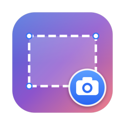
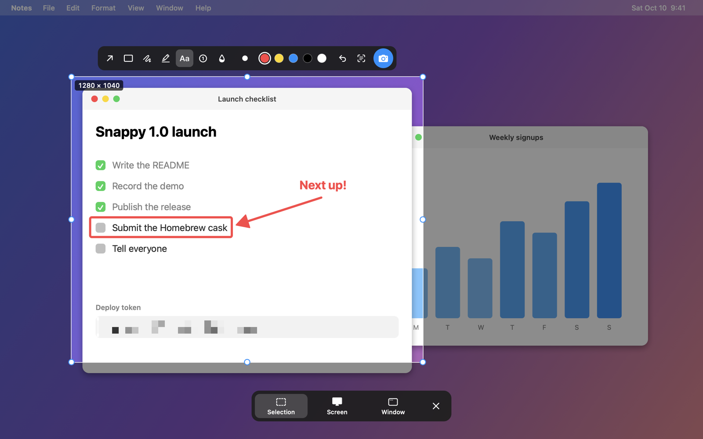

# Snappy

A tiny, Ubuntu-style screenshot tool for macOS. Press one shortcut, pick an area, a window or the whole screen, and click once to capture.



- Lives in the menu bar, no Dock icon
- Freezes the screen while you choose, so menus and tooltips stay put
- Drag to select, then move or resize the selection before capturing
- Quick markup on a selection: arrows, boxes, text and blur (for hiding passwords and personal info)
- One-click full-screen and single-window captures
- Remembers your last selection, so repeat shots of the same area take one click
- Saves a PNG to `~/Pictures/Screenshots` and copies it to the clipboard (both configurable)
- Shows a preview in the corner: click to open it, drag it into any app
- A few small Swift files, no dependencies

## Usage

Press **⌘⇧2** (the default; change it in Settings), or click the menu bar icon → Take Screenshot. A toolbar appears at the bottom of the screen:

| Button | Key | Action |
|---|---|---|
| Selection | `S` | Drag a box. Drag inside it to move, drag the handles to resize. |
| Screen | `C` | Capture the whole screen immediately. |
| Window | `W` | Hover a window to highlight it, click to capture it. |
| ✕ | `Esc` | Cancel (right-click also cancels). |

In Selection mode, click the blue camera button, press `Return`/`Space`, or double-click the selection to capture.

### Markup

A bar next to the selection has markup tools. Pick one, then draw inside the selection:

| Tool | Key | |
|---|---|---|
| Arrow | `A` | Drag from the tail to the tip |
| Box | `R` | Drag a rectangle outline |
| Text | `T` | Click where the text goes, type, press `Return` |
| Blur | `B` | Drag over anything you want to hide; it's pixelated in the saved image |

Pick a colour from the swatches, and undo with the ↩ button or `⌘Z`. Click the active tool again to go back to moving the selection.

The capture covers the display the mouse pointer is on.

After each capture a thumbnail appears in the bottom-right corner for 5 seconds (it stays while you hover it). Click it to open the screenshot, drag it into another app to share it, or click its ✕ to dismiss.

## Install

Requires macOS 14 (Sonoma) or later, on Apple silicon or Intel.

### Homebrew

```sh
brew trust --tap beqaabu/tap   # Homebrew 6+ asks you to trust third-party taps once
brew install --cask beqaabu/tap/snappy-app
```

The cask is `snappy-app` because `snappy` is already Homebrew's name for Google's compression library.

### Download

Grab `Snappy.zip` from the [latest release](https://github.com/beqaabu/Snappy/releases/latest), unzip it and move `Snappy.app` to Applications.

Snappy isn't signed with an Apple Developer ID, so the first time you open it macOS blocks it. Go to **System Settings → Privacy & Security** and click **Open Anyway**.

### Build from source

Needs the Xcode Command Line Tools (`xcode-select --install`).

```sh
git clone https://github.com/beqaabu/Snappy.git
cd Snappy
./build.sh --install
```

This builds a universal `Snappy.app`, copies it to `/Applications` and launches it. Use `./build.sh` alone to only build into `build/`.

The first build creates a self-signed code signing certificate in `signing/` (git-ignored). Keeping that certificate means macOS remembers Snappy's Screen Recording permission across rebuilds.

### Screen Recording permission

On first launch macOS asks for Screen Recording permission. Enable Snappy in **System Settings → Privacy & Security → Screen & System Audio Recording**, then quit and reopen Snappy.


## Settings

Click the menu bar icon → **Settings…** to change:

- **Screenshot shortcut:** click it and press a new combination. It needs ⌘, ⌃ or ⌥, or can be a function key on its own.
- **After capturing:** save to a file, copy to the clipboard (at least one stays on), show the preview, play the shutter sound
- **Files:** the save folder (default `~/Pictures/Screenshots`) and PNG or JPEG
- **Launch at login**

## Customizing the code

The code is in [`Sources/`](Sources). Beyond what Settings covers:

- **Preview duration and size:** `visibleFor` and `maxSize` in [`Preview.swift`](Sources/Preview.swift)
- **Markup colours, line width and font:** [`Markup.swift`](Sources/Markup.swift)

The README image is rendered from the real overlay over a mock desktop: `./tools/render-preview.sh`. The app icon is drawn in code: `./tools/make-icon.sh`.

## Releasing

Run the **Release** workflow from the Actions tab with a version like `1.1.0`. It bumps `Info.plist`, tags, builds, signs, publishes a GitHub release with the changelog, and updates the Homebrew cask.

It needs two repository secrets:

- `SIGNING_P12_BASE64`: `base64 -i signing/id.p12`, so every release is signed with the same certificate
- `HOMEBREW_TAP_TOKEN` (optional): a token that can push to `beqaabu/homebrew-tap`. Without it, the workflow prints the new version and sha256 to put in the cask by hand.

## License

[MIT](LICENSE)
